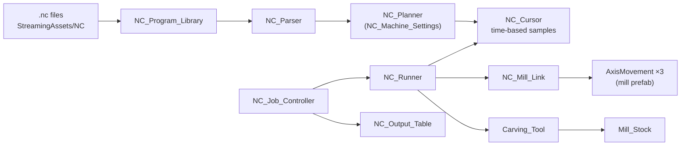

# NC demo — NC programs driving the Intellitek mill

Reads `.nc` programs (ProMill 8000 / CNCBase dialect), plans them, drives the three axes of the
`IntellitekMill_Training` prefab in closed loop, and carves a `Mill_Stock` block per program that
is then set down on an output table under its category. The interpreter is the piece the Digital
Twin's mill station reuses; the job loop is the shape that station will take. Design notes:
`docs/VR_Modules/06_CNCBase_Mockup/05_NC_Interpretation.md`.

## Layout

| Folder | Assembly | Contents |
| --- | --- | --- |
| `NC/` | `NC` (asmdef, no project references) | Parser, planner, cursor, kinematics, program library, machine settings/profile |
| `NC/Tests/Editor/` | `NC.Tests` | 43 EditMode tests, including the shipped programs planning clean |
| `Scripts/` | Assembly-CSharp | Glue that touches `AxisMovement`, `Mill_Doors_Physics` and the Carving components |
| `Editor/` | Assembly-CSharp-Editor | `NC Demo/7 Validate Scene`, `NC Demo/8 Debug - …` |
| `Machine/` | asset | `ProMill_8000.asset` (`NC_Machine_Profile`) |
| `Prefabs/` | assets | `NC_Epoxy_Stock.prefab` (the block: the Digital Twin's epoxy block, 150 x 50 x 100 mm, as a `Mill_Stock` + `Item_Epoxy_Block`), `NC_Stock.prefab` (plain 100 mm block, no longer referenced), `NC_Part_Label.prefab` (table label) |
| `Materials/` | asset | `Epoxy_Stock.mat` - `Assets/Materials/Epoxy.mat` with depth write forced on, so a carved interior sorts; the shared material is untouched |
| `Input/` | asset | `NC_Demo_Input.inputactions` (demo keys; generated wrapper in `Scripts/`) |
| `Scenes/` | scene | `NC_Mill_Demo.unity` — authored; there is no builder |

Programs live in `Assets/StreamingAssets/NC/*.nc` and run in file-name order. The first comment
lines `; KEY: value` fill the program header; `; CATEGORY:` picks the table row.

## Data flow

`NC_Program_Library` is the only file IO. `NC_Kinematics` converts program millimetres to world
metres through the work origin and computes the per-drive delta (`NC_Mill_Link` applies it).

## The axis mapping, declared once

Each `AxisMovement` on the mill moves along one of its **own local** axes (`Axis`) and exposes that
direction in world space (`WorldDirection`); `NC_Mill_Link` names its drives by machine axis —
`Table_X`, `Saddle_Y`, `Spindle_Z` — and projects the tip error onto each drive's direction. Nothing
else in the NC code names an axis, and nothing depends on how the mill instance is rotated in the
scene: the prefab's values — table (machine X) = model X, saddle (machine Y) = model Z, spindle
(machine Z) = model Y — hold everywhere, with no per-scene overrides. `Work_Origin` (a child of
`Stock_Mount`, so it rides the stock drives) is rotated 90° about Y so its local +X is program X
and local +Z is program Y.

Until 2026-09-17 `AxisMovement` moved along a *world* axis. With the model root at Y 270 inside the
wrapper, the prefab's values were wrong wherever the wrapper sat at identity, which is why this
scene carried two `axis` overrides and Module 1 ran its table across its width. Both are gone; the
local-axis drive is the fix.

## Machine settings

`NC_Machine_Settings` (serializable, on the `NC_Machine_Profile` asset) holds rapid rate, the
default feed used when a program never sets `F`, arc tolerance, G83 peck clearance and the
M00/M01 pause. The defaults are the ProMill user-guide figures; the rapid/feed values are still
unverified against the lab machine (`04_CNCBase_Reference.md` §5.1), which is why they are an
asset rather than constants. Every `NC_Plan` carries the settings it was planned with.

## Supported codes

- Motion G00–G03 (I/J or R arcs, helical Z), G04 dwell (`F` = seconds), G28 home, G90/G91,
  G70/G71 and G20/G21, G80–G83 canned cycles with R/Q/P and G98/G99, M00/M01, M02/M30,
  M03/M04/M05 + S, M06 + T.
- Accepted with an **Info** notice and no effect: G43/G49 (tool length comes from the tool
  definition), G54–G59 (the work origin is the only datum), M08/M09.
- **Warning** and no motion: anything else, G18/G19, G41/G42, `$` absolute arc centres.
- **Alarm** (planned, then the run retracts and homes): arc radius mismatch, impossible R arcs,
  a cycle whose Z is not below R, and at run time a soft limit (a `MoveBy` the drive clamped).

## Running the demo

Open `Scenes/NC_Mill_Demo.unity`, press Play; the job loop starts on its own. Keys (bindings in
`Input/NC_Demo_Input.inputactions`): **Space** pause, **N** skip file, **R** restart, **[ ]** feed
override (×0.5 / ×2, clamped 25–1000 %), **1/2/3** camera views. Click the Game view first.

Editor menus:

- `NC Demo/7 Validate Scene` — every reference, three distinct drive axes, `Work_Origin` at the
  stock's front-left-top corner, rack/slot pairing, table rows, and that every shipped program
  plans without warnings using only tools the rack has.
- `NC Demo/8 Debug - Feed Override 1000% / 100%`, `Skip File`, `Restart`, `Next View` — the
  keyboard actions, callable over MCP in Play mode.

Tests: Test Runner → EditMode → `NC.Tests`.

## Components

| Component | Where | Role |
| --- | --- | --- |
| `NC_Job_Controller` | `NC_Demo` object | Doors → stock in → run → doors → table, for every program. Reusable. |
| `NC_Runner` | `NC_Demo` | Runs one plan: samples, alarms, tool changes, homing. Reusable. |
| `NC_Mill_Link` | `NC_Demo` | The drives, holder and work origin; closed-loop tip positioning. Reusable. |
| `NC_Tool_Rack` | `Tool_Rack` | T-number → `Carving_Tool`, park slots, teleport tool changes. |
| `NC_Output_Table` | `Output_Table_Top` | Authored rows/slots + label prefab. Demo furniture. |
| `NC_Demo_Readout` | `HUD` | CNCBase-style text readout (TMP, 10×/s). The CNCBase panel will replace it. |
| `NC_Demo_Controls` | `NC_Demo` | Keyboard and camera views. Demo only. |

## For the Digital Twin

- The per-part datum: here `Work_Origin` is authored once under the mount because every program
  cuts the same block in the same vise. A slotted-table workflow needs the origin per part
  (front-left-top corner of the part as mounted); a child transform on the part prefab, assigned
  to `NC_Mill_Link` when the part is loaded, is the natural replacement.
- Tool changes and stock loading are teleports by design; animation is a separate step.
- `NC_Epoxy_Stock.prefab` is a plain prefab, not a variant of `Assets/Game_Objects/Item/Item_Epoxy_Block.prefab`: that prefab is rooted on `EpoxyBlock.fbx`, whose root node is scaled 100 with the pivot at the block centre, while `Mill_Stock` expects unit scale with its origin at the min corner. Promoting carving to the shared item means a unit-scale child at -Size/2 carrying `Mill_Stock`, and the job controller and output table would then have to handle a `Mill_Stock` that is not the prefab root.
- `Mill_Stock` is disabled once a part is finished so its mesh stops being checked for remesh.
