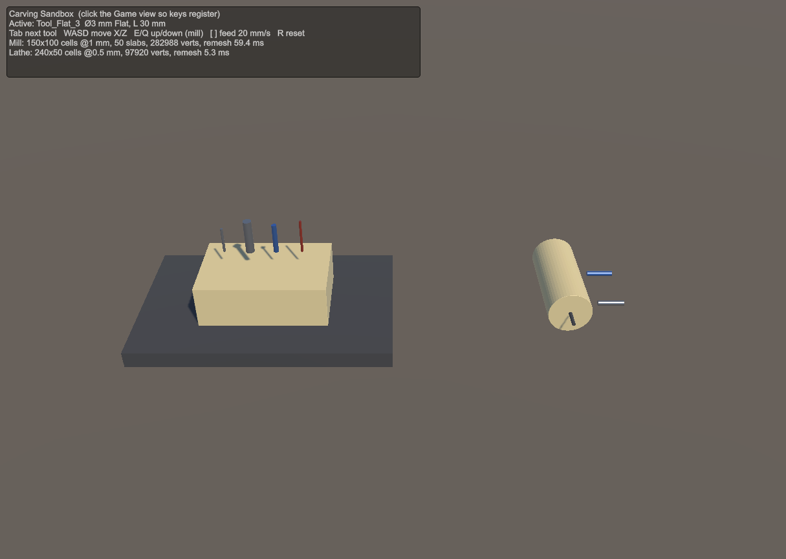
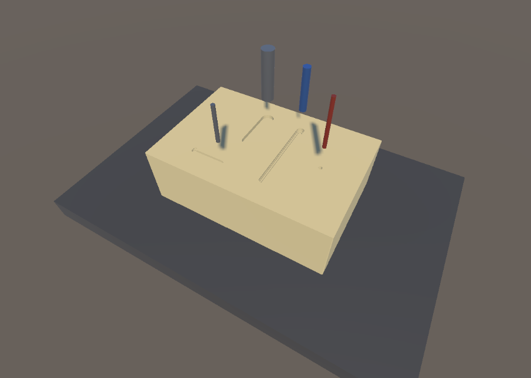
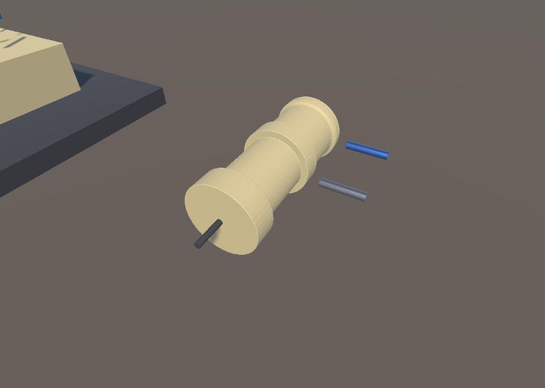
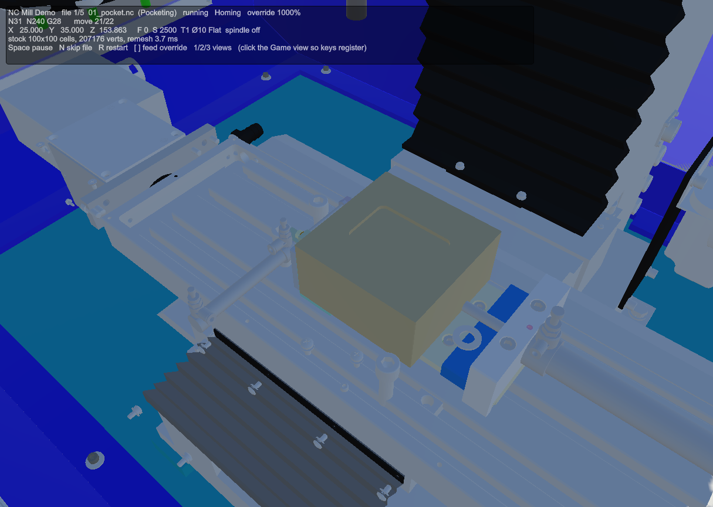
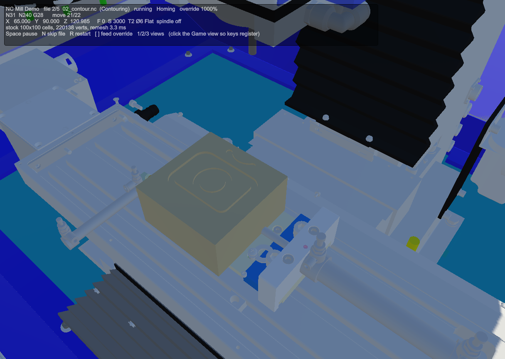
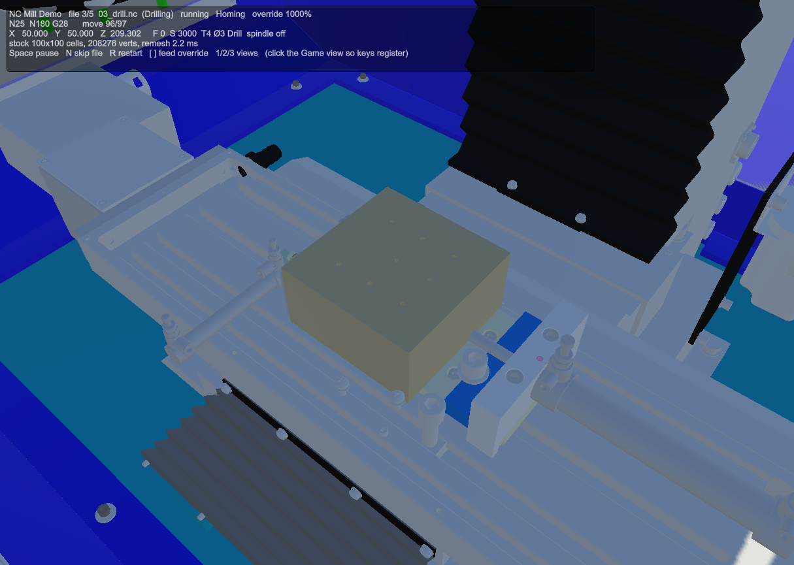
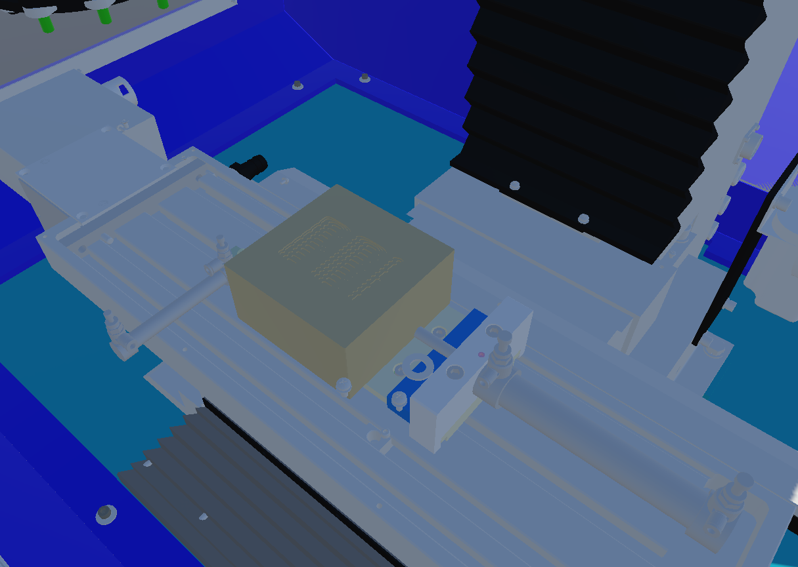
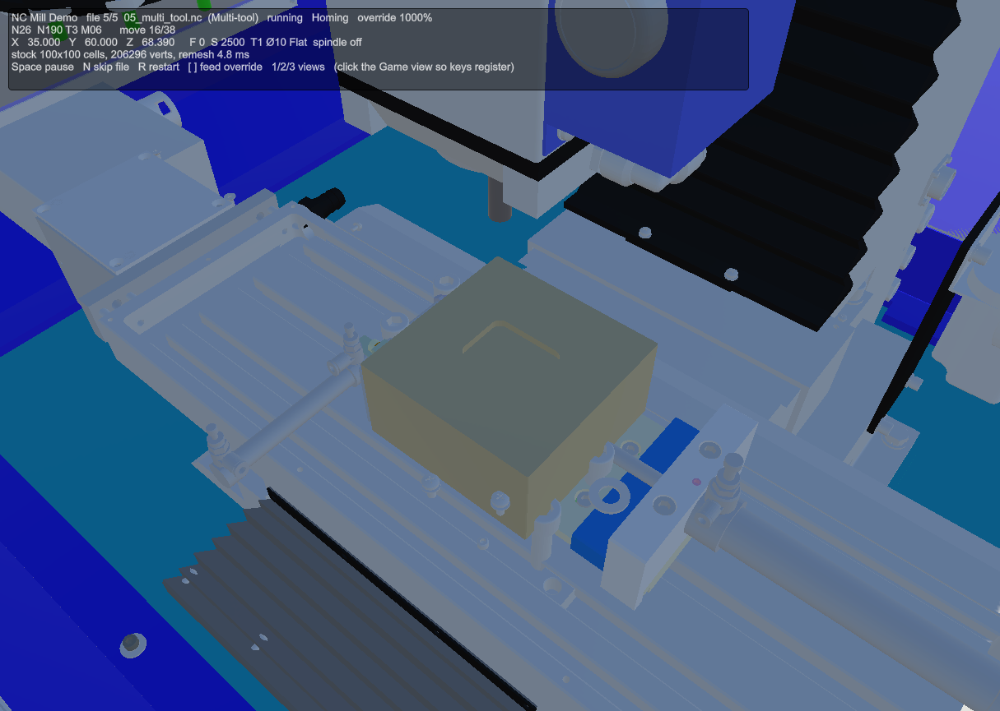
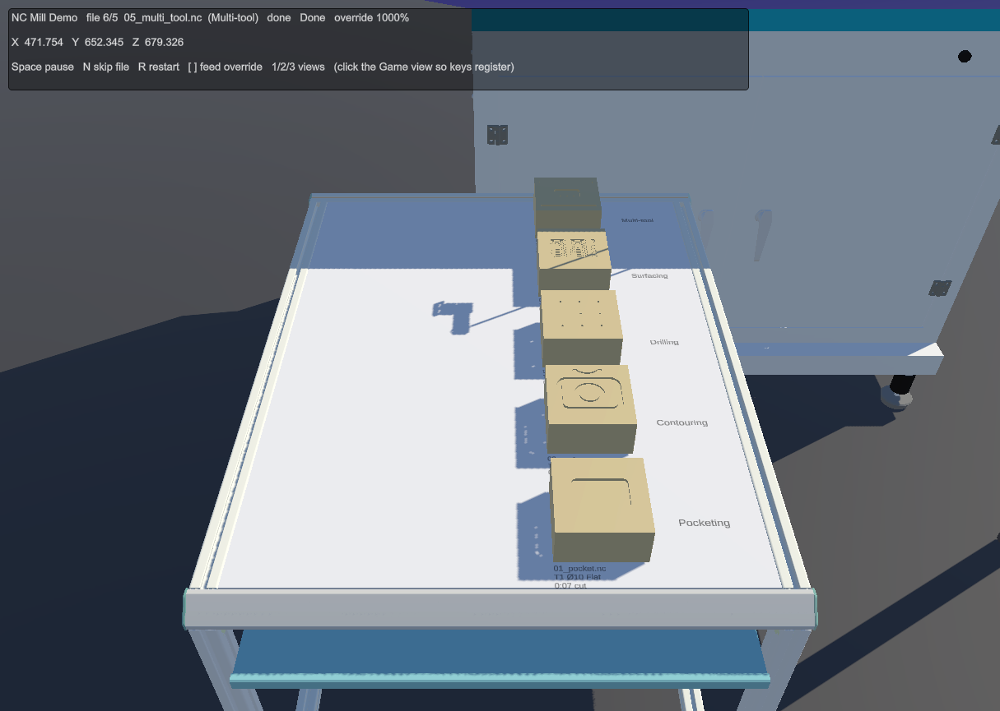

# Progress — week of 2026-09-02 → 2026-09-09

Branch `Colin`. Two commits, both new subsystems built as isolated sandboxes under
`Assets/Members/Colin/` — neither touches `DigitalTwin.unity`, the training modules, or
the shared `IntellitekMill_Training` prefab.

| Commit | Date | Title |
| --- | --- | --- |
| `7f70791` | 2026-09-02 | feat(carving): stacked-slice marching-squares sandbox for mill and lathe |
| `62a1029` | 2026-09-04 | feat(nc-demo): NC-driven Intellitek mill demo carving stock per program |

Net: 121 files changed — 119 added, 2 modified — and ~9,000 lines inserted. 62 EditMode
tests, across five new assembly definitions. These are the first asmdefs in the project's
own code; the only others in the repo ship with the XR Interaction Toolkit samples.

---

## 1. Carving sandbox — `7f70791`

A procedural material-removal spike: stock is a scalar field, tools subtract from it, and
the visible mesh is re-contoured every frame. The user picked the stacked-slice
marching-squares approach over the Z-map alternative in the design doc.

**How it works**

- `Scalar_Field_2D` — padded, clamped-SDF grid with disc/shape subtraction.
- `Marching_Squares` — 16-case contour + fill tables, centre-average saddle resolution,
  canonical edge crossings so adjacent cells share vertices (watertight seams).
- `Mill_Stock_Data` — N horizontal slabs; walls extruded from contours, caps culled when
  the neighbouring slab is at least as solid, which keeps thin rings intact.
- `Lathe_Stock_Data` — one `(z, r)` field revolved, mirrored axis row, fan apex.
- `Tool_Profile` — diameter + Flat/Ball/Drill tip, with mill-footprint and lathe-section
  SDFs. Motion is sub-stepped at half a cell so fast sweeps stay solid.
- `Tool_Jog` — Input System keyboard jog plus an OnGUI stats readout.

**Scene:** `Assets/Members/Colin/Carving/Scenes/Carving_Sandbox.unity` (not in build settings)

Six dummy cylinder tools over two stations. Mill stock is 150×100 cells @ 1 mm across 50
slabs; lathe stock is 240×50 cells @ 0.5 mm. Remesh cost is shown live in the readout —
5–60 ms for the mill, ~2–5 ms for the lathe.

Mill stock after the demo cuts — four tools have each cut a groove into the top face,
showing flat, ball and drill tip footprints:

Lathe stock after turning — stepped diameters from the section SDF, plus a bore drilled
into the end face:

**Tests:** 23 EditMode tests (`Carving.Tests`), including watertight-mesh checks via
`Mesh_Check`.

---

## 2. NC mill demo — `62a1029`

Drives the real `IntellitekMill_Training` wrapper from ProMill 8000 NC programs, carving a
`Mill_Stock` block per file and setting each finished block on an output table under its
`; CATEGORY:` header.

**The pure `NC` assembly** (no Unity scene dependencies) covers G00–G03, G04, G28,
G70/71/20/21, G80–G83 canned cycles with G98/99, G90/91, M00/01/02/30, M03/04/05,
M06+T, both I/J and R arcs, and helical Z.

**The Assembly-CSharp glue:**

- `NC_Mill_Link` — drives the axes keyed by *world* axis, and raises a residual soft-limit
  alarm.
- `NC_Tool_Rack` — teleport tool changes.
- `NC_Runner`, `NC_Output_Table` (rows by category, TMP labels), `NC_Demo_Controller`
  (job loop, doors, overlay, keys).

Axis mapping was corrected as **scene-only overrides** on the three `AxisMovement`
instances — table along world Z, saddle along world X. The prefab and Module 1 are
untouched. Spindle nose was measured from CAD node `IKX10226` (y 1.5305).

**Scene:** `Assets/Members/Colin/NC_Demo/Scenes/NC_Mill_Demo.unity` (not in build settings)

### The five programs

All five plan with zero notices. Screenshots below are from a full unattended run at 1000%
feed override; the overlay is the CNCBase-style readout (line number, modal state, position,
feed/speed, active tool, live vert count and remesh time).

| File | Category | Tool |
| --- | --- | --- |
| `01_pocket.nc` | Pocketing | T1 Ø10 Flat |
| `02_contour.nc` | Contouring | T2 Ø6 Flat |
| `03_drill.nc` | Drilling | T4 Ø3 Drill |
| `04_wave.nc` | Surfacing | T3 Ø6 Ball |
| `05_multi_tool.nc` | Multi-tool | T1 / T3 / T4 |

Pocketing — rectangular pocket cut into the stock, table travelling under the spindle:

Contouring — square and circular contours, cut with the Ø6 flat:

Drilling — G81/G83 peck cycle leaves a hole grid in the top face:

Surfacing — ball-nose sweep, 148 moves, leaving the wave scallop pattern:

Multi-tool — three tool changes in one program via M06 + T:

### Output table

Each finished block is set down in the row for its category, labelled with the source file,
tool and cut depth. All five parts after a complete run:

**Tests:** 39 EditMode tests (`NC.Tests`) covering parser, planner, cursor and kinematics.

### Supporting change to the carving code

`Carving_Tool` now tracks its last tip in **stock-local** space (`Bind` re-seeds it) and
`Mill_Stock` gained `Carve_Local`, so a stock sitting on a moving machine table carves the
relative motion rather than only the tool's own delta.

---

## Scenes touched this week

| Scene | Status | In build settings |
| --- | --- | --- |
| `Carving/Scenes/Carving_Sandbox.unity` | new | no |
| `NC_Demo/Scenes/NC_Mill_Demo.unity` | new | no |
| `Scenes/DigitalTwin.unity` | untouched | — |
| Training module scenes | untouched | — |

## Running it yourself

*Updated 2026-09-11 after the code review (see below): the `1 Build` menu items are gone — both
scenes are authored artifacts now.*

Both scenes are driven from menu items, which also work over MCP in Play mode:

- `Carving/7 Validate Scene` — checks the sandbox scene's wiring after any hand edit.
- `Carving/8 Debug - Run Demo Cuts` — drives all six tools (Play mode); `Reset Stocks`.
- `NC Demo/7 Validate Scene` — checks the demo scene, the axis overrides and that every shipped
  program plans clean with tools the rack has.
- `NC Demo/8 Debug - Feed Override 1000% / 100% / Skip File / Restart / Next View` (Play mode).

In the NC demo, keyboard control is Space pause, N skip file, R restart, `[` `]` feed
override, 1/2/3 camera views. Each folder has a `README.md` with the layout and the
integration notes.

## Code review, 2026-09-11

Both folders were reviewed and refactored so they can be the basis of the Digital Twin's
material transformation (`Assets/Members/Colin/Carving/README.md`,
`Assets/Members/Colin/NC_Demo/README.md`):

- The two scene builders were deleted; the scenes are authored and validated by the `7` menus.
- `Mill_Stock` is one GameObject with one mesh (it used to build 50 slab objects at Play).
  Remesh cost is unchanged: ~9 ms in the sandbox, up to ~50 ms in the NC demo at 1000 %.
- Every inspector field is `[SerializeField] private` with a null guard; no more `Find` by name,
  `Shader.Find`, `Camera.main`, `OnGUI` or shared static scratch buffers.
- Tools are `Tool_Definition` assets (`Carving/Tools/`) shared by both scenes; machine numbers
  are an `NC_Machine_Profile` asset; keys come from `.inputactions` assets.
- The axis mapping is declared once, by each drive's `Axis`; `NC_Mill_Link` names its drives
  by machine axis. The Module 1 discrepancy is documented, not changed.
- Tests: 25 + 43 EditMode, all green. New: flat-normal checks (which caught that
  `Vector3.normalized` zeroes millimetre-scale normals), machine settings, ignored-code notices,
  unterminated comments, program library.

The known issue below is fixed: both stocks guard the carve path and `Reset_Stock` rebuilds the
field after a script reload during Play.

## Known issue (fixed 2026-09-11)

`Mill_Stock.Carve_Local` threw a `NullReferenceException` when `Data` was null, reached via
`Carving_Tool.Carve_Step` from `Tool_Jog.Update`. `Data` is not serialized, so a script reload
during Play emptied it and the exception then repeated every frame in the sandbox scene.
